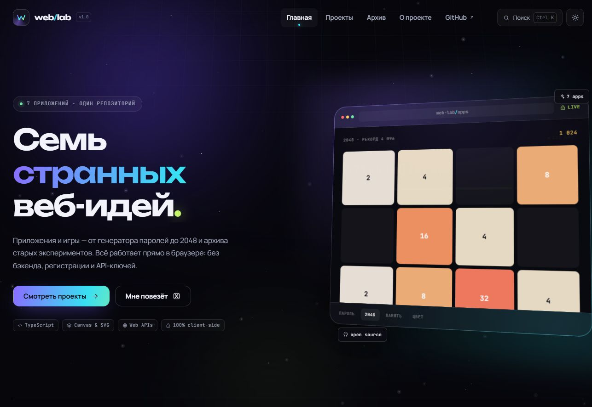
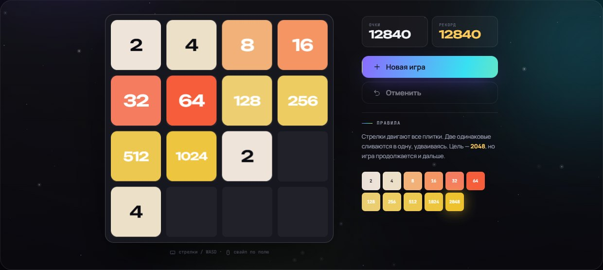
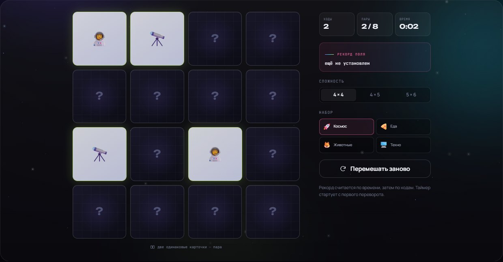
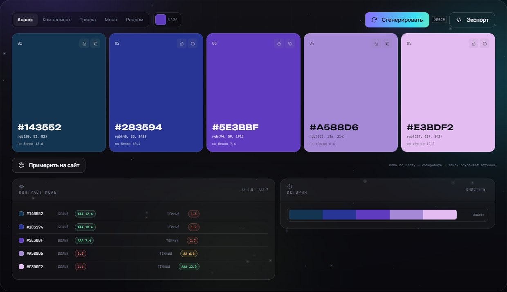
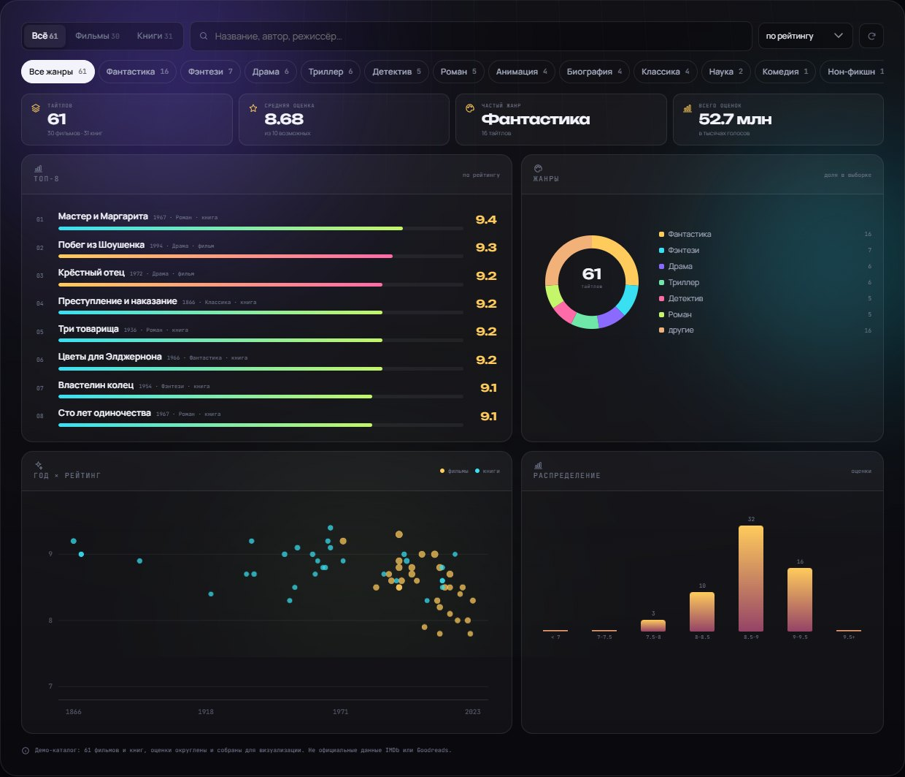
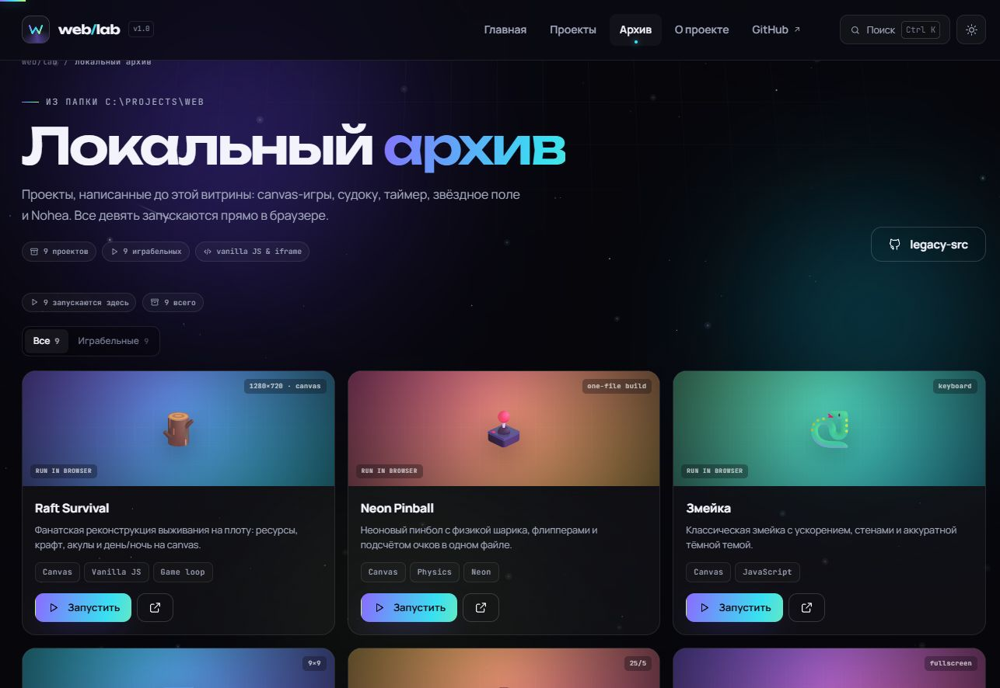
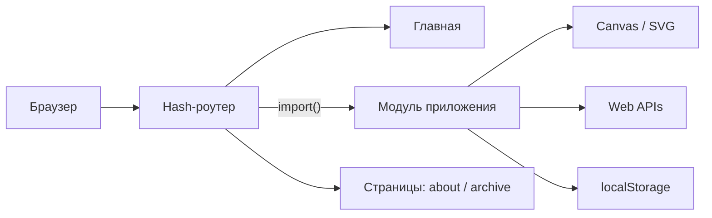

<div align="center">


# web/lab

**Семь интерактивных веб-приложений в одном статическом сайте.**
Генератор паролей, 2048, Memory, палитры, дашборд рейтингов, Motion Lab и локальный архив — без бэкенда, регистрации и API-ключей. QR, погода, карта неба, блокнот и расписание живут в отдельных репозиториях.

[**Открыть демо →**](https://d1m40fficial.github.io/web-projects/) · [Приложения](#приложения) · [Архив](#локальный-архив) · [Как устроено](#как-это-устроено)

[](https://d1m40fficial.github.io/web-projects/)
[](https://www.typescriptlang.org/)
[](https://vite.dev/)
[](https://d1m40fficial.github.io/web-projects/)
[](LICENSE)

</div>

---

## Что это

**web/lab** — витрина фронтенд-навыков, в которой нет ни одного скриншота вместо приложения. Каждая карточка открывает работающий инструмент, игру или визуализацию со своей логикой, состоянием и визуальным языком.

Внутри — **7 приложений** и **9 архивных проектов**, которые запускаются прямо в браузере. Всё считается на клиенте: игровая логика, палитры, SVG-графики и CSS-анимации написаны руками, а не спрятаны за готовой библиотекой.

> Сайт живёт на GitHub Pages, поэтому единственная инфраструктура — статические файлы. Состояние хранится в `localStorage`, данные приходят из открытых API, а если сети нет — включается честно помеченный демо-режим.

<div align="center">
  
</div>

## Приложения

| # | Приложение | Что делает | Стек | Демо |
|---|------------|------------|------|------|
| 01 | 🔑 **Генератор паролей** | Пароли и passphrase на `crypto.getRandomValues`, энтропия, время взлома, история | TypeScript · Web Crypto | [Открыть](https://d1m40fficial.github.io/web-projects/#/app/password) |
| 02 | 🔢 **2048** | Полный клон: слияния, отмена, рекорд, победа и продолжение | TypeScript · CSS transforms | [Открыть](https://d1m40fficial.github.io/web-projects/#/app/2048) |
| 03 | 🃏 **Memory** | Три поля, 3D-переворот, таймер, ходы и рекорды | TypeScript · CSS 3D | [Открыть](https://d1m40fficial.github.io/web-projects/#/app/memory) |
| 04 | 🎨 **Палитры** | Гармонии, блокировка цветов, WCAG-контраст, примерка на сайт | TypeScript · color science · CSS vars | [Открыть](https://d1m40fficial.github.io/web-projects/#/app/palette) |
| 05 | 📊 **Дашборд рейтингов** | Фильтры, топ-8, донат жанров, скэттер «год × рейтинг», гистограмма | TypeScript · SVG · data viz | [Открыть](https://d1m40fficial.github.io/web-projects/#/app/ratings) |
| 06 | 🎛️ **Motion Lab** | Easing-плейграунд, ripple, магнитные кнопки, 3D-карточки, скелетоны | TypeScript · Web Animations API | [Открыть](https://d1m40fficial.github.io/web-projects/#/app/motion) |
| 07 | 🗂️ **Локальный архив** | Девять HTML-игр в iframe и браузерный Nohea | HTML · JavaScript · iframe | [Открыть](https://d1m40fficial.github.io/web-projects/#/archive) |

### Отдельные репозитории

Пять проектов переехали в собственные репозитории со своим дизайном и деплоем:

| Проект | Что это | Репозиторий |
|--------|---------|-------------|
| 🔳 **QR Studio** | QR-коды в печатной эстетике | [qr-studio](https://github.com/d1m40fficial/qr-studio) |
| 🌤️ **Атмосфера** | погода на Gismeteo | [weather](https://github.com/d1m40fficial/weather) |
| ✨ **Orbita** | панорама звёздного неба | [sky-map](https://github.com/d1m40fficial/sky-map) |
| 📝 **plain** | минималистичный блокнот | [notes](https://github.com/d1m40fficial/notes) |
| 📅 **Расписание** | пары преподавателей из Google Таблиц | [teacher-schedule](https://github.com/d1m40fficial/teacher-schedule) |

### Несколько крупных планов

| 2048 | Memory |
|:---:|:---:|
| [](https://d1m40fficial.github.io/web-projects/#/app/2048) | [](https://d1m40fficial.github.io/web-projects/#/app/memory) |

| Палитры | Дашборд рейтингов |
|:---:|:---:|
| [](https://d1m40fficial.github.io/web-projects/#/app/palette) | [](https://d1m40fficial.github.io/web-projects/#/app/ratings) |

## Локальный архив

Девять проектов из папки `C:\Projects\WEB` встроены как есть и запускаются в песочнице. Nohea переписан с Python/Tkinter на браузерный HTML/JS.

| Проект | Тип | Запуск |
|--------|-----|--------|
| 🪵 **Raft Survival** | Canvas-выживание на плоту | [Играть](https://d1m40fficial.github.io/web-projects/legacy/raft/index.html) |
| 🕹️ **Neon Pinball** | Неоновый пинбол | [Играть](https://d1m40fficial.github.io/web-projects/legacy/pinball/index.html) |
| 🐍 **Змейка** | Классика на canvas | [Играть](https://d1m40fficial.github.io/web-projects/legacy/snake/index.html) |
| 🔢 **Судоку** | Генератор и решатель | [Играть](https://d1m40fficial.github.io/web-projects/legacy/sudoku/index.html) |
| ⏱️ **Pomodoro Timer** | Таймер фокуса | [Играть](https://d1m40fficial.github.io/web-projects/legacy/timer/index.html) |
| 🌌 **Starfield** | Параллакс-звёзды | [Играть](https://d1m40fficial.github.io/web-projects/legacy/starfield/index.html) |
| 🐂 **Быки и коровы** | Логическая игра | [Играть](https://d1m40fficial.github.io/web-projects/legacy/bulls/index.html) |
| 🚀 **Space Club** | Аркадный шутер | [Играть](https://d1m40fficial.github.io/web-projects/legacy/space-club/index.html) |
| 🧮 **Nohea** | Устный счёт и память, 5–15 минут | [Играть](https://d1m40fficial.github.io/web-projects/legacy/japanese-math/index.html) |

Полная версия — [web/lab/archive](https://d1m40fficial.github.io/web-projects/#/archive).

<div align="center">
  
</div>

## Как это устроено



- **Один вход, много вселенных.** Каждое приложение — независимый модуль с `mount(root)` и функцией очистки. Роутер подгружает только нужный чанк.
- **Hash-роутинг** выбран осознанно: GitHub Pages не умеет отдавать `index.html` для вложенных путей, а `#/app/memory` работает всегда.
- **Без фреймворка.** Свой роутер, реестр приложений, компоненты, дизайн-токены и утилиты — чтобы показать платформу, а не обёртку.
- **Честные вычисления.** Игровая логика, генерация палитр, SVG-графики и CSS-анимации написаны в репозитории.

### Стек

- **TypeScript 5** в strict-режиме, ES2022, никаких `any` в прикладной логике.
- **Vite 7** — dev server, code splitting, сборка статики.
- **Canvas 2D и SVG** — плитки 2048, карточки Memory, графики дашборда.
- **Web APIs** — Web Crypto, Clipboard, `IntersectionObserver`, Web Animations.
- **CSS** — свои токены, тёмная и светлая темы, адаптив, `prefers-reduced-motion`, 3D-трансформации.
- **Ноль бэкенда** — GitHub Pages, `localStorage`, статические данные.

### Структура

```text
web-projects/
├─ src/
│  ├─ apps/            # 7 приложений (по папке на приложение)
│  ├─ core/            # router, dom, motion, scene, toast, modal, confetti
│  ├─ components/      # nav, footer, command palette, превью карточек
│  ├─ pages/           # home, about, archive, app shell
│  ├─ data/            # реестр проектов, демо-рейтинги
│  └─ styles/          # design system + стили приложений
├─ public/
│  ├─ legacy/          # 9 архивных проектов, включая Nohea
│  ├─ og-cover.png
│  ├─ favicon.svg
│  └─ 404.html
├─ legacy-src/         # оригинальные исходники архива
├─ docs/               # скриншоты для README
├─ index.html
├─ vite.config.ts
└─ package.json
```

## Запуск

```bash
git clone https://github.com/d1m40fficial/web-projects.git
cd web-projects
npm install
npm run dev
```

Сайт откроется на `http://localhost:5173/web-projects/`.

```bash
npm run check     # tsc --noEmit
npm run build     # typecheck + production build в dist/
npm run preview   # локальный просмотр сборки
```

## Деплой

Исходники живут в ветке `main`, собранный сайт — в `gh-pages`. GitHub Pages настроен на `gh-pages / (root)`.

```bash
npm run build
cd dist
git add -A
git commit -m "deploy: web/lab"
git push https://github.com/d1m40fficial/web-projects.git gh-pages
```

> В сборке используется `base: '/web-projects/'`, поэтому пути к ассетам и iframe-играм корректны и на Pages, и в локальном dev-сервере.

Отдельные репозитории (`qr-studio`, `weather`, `sky-map`, `notes`, `teacher-schedule`) собираются в папку `docs/` и публикуются с `main / docs`.

## Данные и честность

- **Отдельные проекты** — QR, погода (Gismeteo/Open-Meteo), карта неба, блокнот и расписание живут в собственных репозиториях; эта витрина их не собирает.
- **Дашборд** — демонстрационный каталог из 61 фильма и книги. Оценки округлены и приблизительны; это не официальные данные IMDb или Goodreads.
- **Локальный архив** — проекты написаны до витрины; восемь встроены без изменений, Nohea переписан на HTML/JS для запуска в браузере. Raft Survival — некоммерческая фанатская работа, см. [CREDITS](public/legacy/raft/CREDITS.txt).
- **Приватность** — нет аналитики, cookies, аккаунтов и серверного кода. Пароли, рекорды и палитры остаются в браузере.

## Доступность и производительность

- Клавиатурная навигация, видимый `:focus-visible`, семантические ориентиры и `aria`-подписи.
- `prefers-reduced-motion` отключает декоративное движение, но сохраняет обратную связь.
- Контраст проверяется в палитрах по WCAG AA/AAA; обе темы проходят по основному тексту.
- Главная не тянет код приложений: каждый экран — отдельный чанк, загружаемый по маршруту.
- Графики и плитки рисуются на canvas с учётом `devicePixelRatio`; никаких тяжёлых chart-библиотек.

## Лицензия

Код и дизайн витрины — [MIT](LICENSE). Архивные проекты и сторонние данные остаются под своими условиями; подробности — в [LICENSE](LICENSE) и `public/legacy/raft/CREDITS.txt`.

---

<div align="center">

Сделано вручную · **d1m40fficial** · 2026

[GitHub](https://github.com/d1m40fficial) · [Live demo](https://d1m40fficial.github.io/web-projects/) · [Issues](https://github.com/d1m40fficial/web-projects/issues)

</div>
