<div align="center">

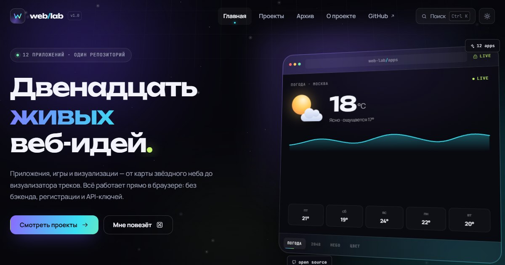

# web/lab

**Двенадцать интерактивных веб-приложений в одном статическом сайте.**
Карта звёздного неба, погода, 2048, QR-коды, визуализатор треков, палитры, дашборд и локальный архив — без бэкенда, регистрации и API-ключей.

[**Открыть демо →**](https://d1m40fficial.github.io/web-projects/) · [Приложения](#приложения) · [Архив](#локальный-архив) · [Как устроено](#как-это-устроено)

[](https://d1m40fficial.github.io/web-projects/)
[](https://www.typescriptlang.org/)
[](https://vite.dev/)
[](https://d1m40fficial.github.io/web-projects/)
[](LICENSE)

</div>

---

## Что это

**web/lab** — витрина фронтенд-навыков, в которой нет ни одного скриншота вместо приложения. Каждая карточка открывает работающий инструмент, игру или визуализацию со своей логикой, состоянием и визуальным языком.

Внутри — **12 приложений** и **11 архивных проектов** (9 из них запускаются прямо в браузере). Всё считается на клиенте: астрономия, геодезия, QR-кодирование, парсинг GPX, Markdown и графики написаны руками, а не спрятаны за готовой библиотекой.

> Сайт живёт на GitHub Pages, поэтому единственная инфраструктура — статические файлы. Состояние хранится в `localStorage`, данные приходят из открытых API, а если сети нет — включается честно помеченный демо-режим.

<div align="center">
  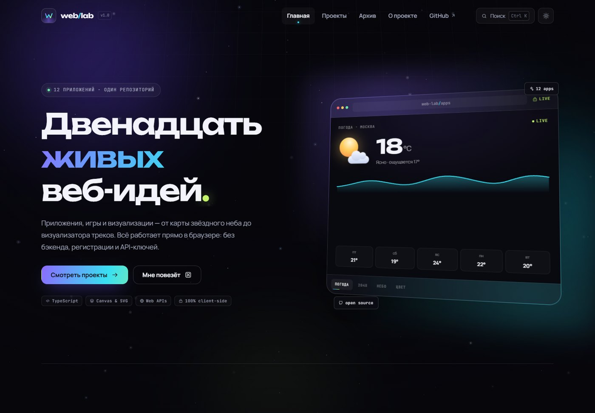
</div>

## Приложения

| # | Приложение | Что делает | Стек | Демо |
|---|------------|------------|------|------|
| 01 | 🔑 **Генератор паролей** | Пароли и passphrase на `crypto.getRandomValues`, энтропия, время взлома, история | TypeScript · Web Crypto | [Открыть](https://d1m40fficial.github.io/web-projects/#/app/password) |
| 02 | 🔳 **QR-студия** | Ссылки, текст, Wi-Fi и e-mail; цвета, коррекция ошибок, PNG/SVG | TypeScript · Canvas · QR encoder | [Открыть](https://d1m40fficial.github.io/web-projects/#/app/qr) |
| 03 | 🌤️ **Погода** | Любой город, анимированные иконки, 24 часа и 7 дней, геолокация | TypeScript · Open-Meteo · SVG | [Открыть](https://d1m40fficial.github.io/web-projects/#/app/weather) |
| 04 | ✨ **Карта звёздного неба** | 100+ звёзд, 25 созвездий, Млечный Путь, Солнце и Луна с фазой | TypeScript · Canvas 2D · астрономия | [Открыть](https://d1m40fficial.github.io/web-projects/#/app/sky) |
| 05 | 📝 **Блокнот** | Markdown, теги, поиск, закрепление, автосохранение и экспорт | TypeScript · localStorage | [Открыть](https://d1m40fficial.github.io/web-projects/#/app/notes) |
| 06 | 🔢 **2048** | Полный клон: слияния, отмена, рекорд, победа и продолжение | TypeScript · CSS transforms | [Открыть](https://d1m40fficial.github.io/web-projects/#/app/2048) |
| 07 | 🃏 **Memory** | Три поля, 3D-переворот, таймер, ходы и рекорды | TypeScript · CSS 3D | [Открыть](https://d1m40fficial.github.io/web-projects/#/app/memory) |
| 08 | 🥾 **Визуализатор треков** | GPX / GeoJSON / CSV, карта, профиль высоты, скорость и плеер | TypeScript · Canvas · геодезия | [Открыть](https://d1m40fficial.github.io/web-projects/#/app/tracks) |
| 09 | 🎨 **Палитры** | Гармонии, блокировка цветов, WCAG-контраст, примерка на сайт | TypeScript · color science · CSS vars | [Открыть](https://d1m40fficial.github.io/web-projects/#/app/palette) |
| 10 | 📊 **Дашборд рейтингов** | Фильтры, топ-8, донат жанров, скэттер «год × рейтинг», гистограмма | TypeScript · SVG · data viz | [Открыть](https://d1m40fficial.github.io/web-projects/#/app/ratings) |
| 11 | 🎛️ **Motion Lab** | Easing-плейграунд, ripple, магнитные кнопки, 3D-карточки, скелетоны | TypeScript · Web Animations API | [Открыть](https://d1m40fficial.github.io/web-projects/#/app/motion) |
| 12 | 🗂️ **Локальный архив** | Старые HTML-игры в iframe и Python-проекты в исходниках | HTML · JavaScript · Python | [Открыть](https://d1m40fficial.github.io/web-projects/#/archive) |

### Несколько крупных планов

| Карта неба | Погода |
|:---:|:---:|
| [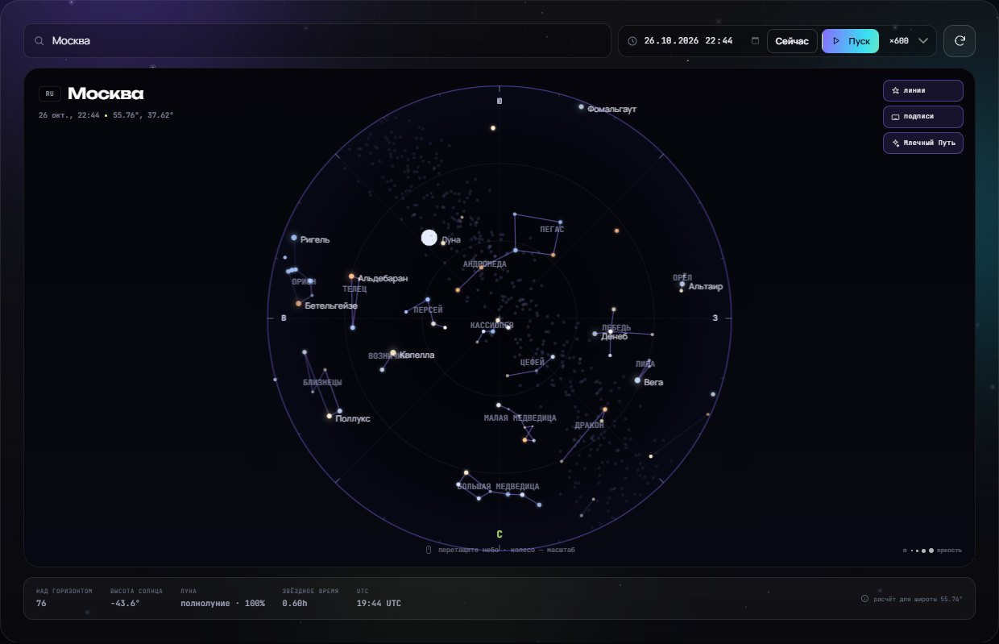](https://d1m40fficial.github.io/web-projects/#/app/sky) | [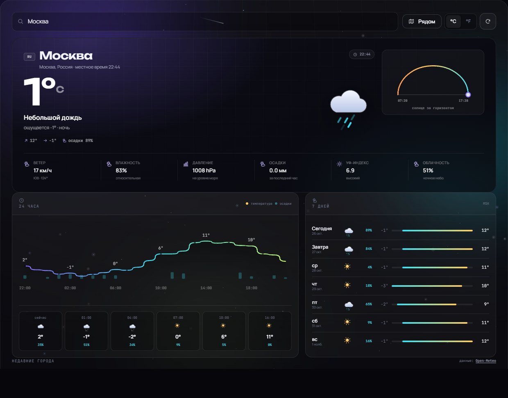](https://d1m40fficial.github.io/web-projects/#/app/weather) |

| Визуализатор треков | Дашборд рейтингов |
|:---:|:---:|
| [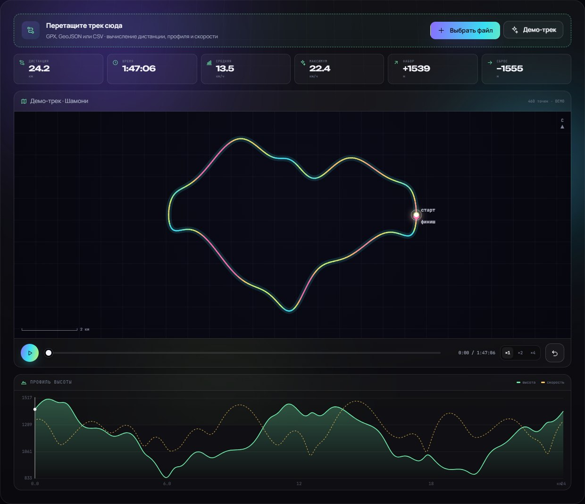](https://d1m40fficial.github.io/web-projects/#/app/tracks) | [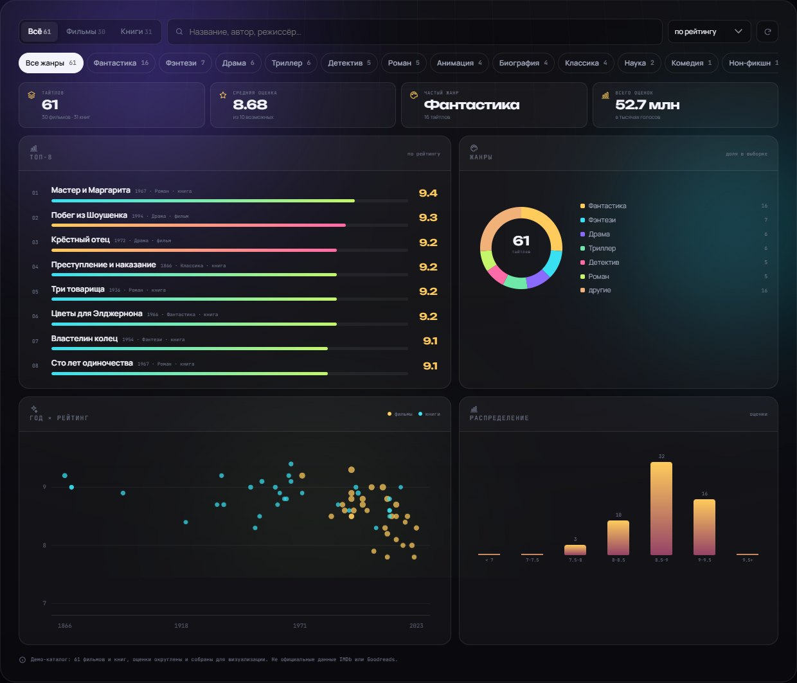](https://d1m40fficial.github.io/web-projects/#/app/ratings) |

| 2048 | Memory |
|:---:|:---:|
| [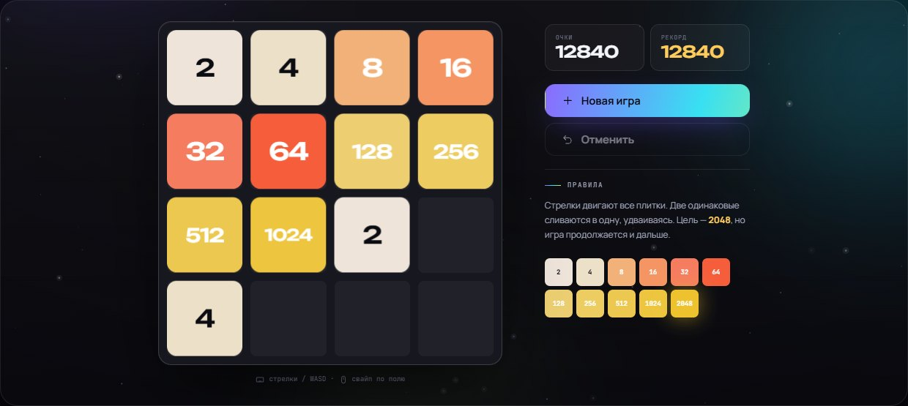](https://d1m40fficial.github.io/web-projects/#/app/2048) | [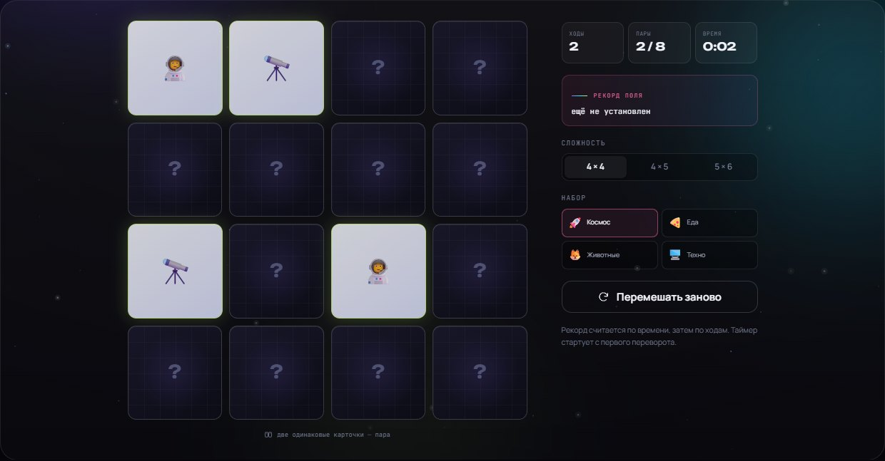](https://d1m40fficial.github.io/web-projects/#/app/memory) |

| Блокнот | Палитры |
|:---:|:---:|
| [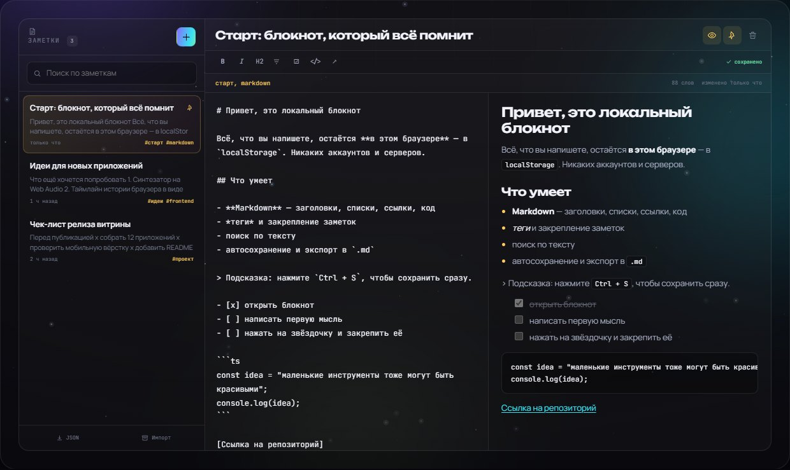](https://d1m40fficial.github.io/web-projects/#/app/notes) | [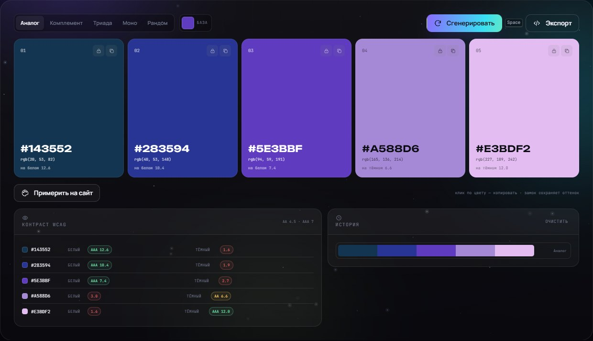](https://d1m40fficial.github.io/web-projects/#/app/palette) |

## Локальный архив

Девять проектов из папки `C:\Projects\WEB` встроены как есть и запускаются в песочнице, ещё два открыты исходниками.

| Проект | Тип | Запуск |
|--------|-----|--------|
| 🪵 **Raft Survival** | Canvas-выживание на плоту | [Играть](https://d1m40fficial.github.io/web-projects/legacy/raft/index.html) |
| 🕹️ **Neon Pinball** | Неоновый пинбол | [Играть](https://d1m40fficial.github.io/web-projects/legacy/pinball/index.html) |
| 🐍 **Змейка** | Классика на canvas | [Играть](https://d1m40fficial.github.io/web-projects/legacy/snake/index.html) |
| 🔢 **Судоку** | Генератор и решатель | [Играть](https://d1m40fficial.github.io/web-projects/legacy/sudoku/index.html) |
| ⏱️ **Pomodoro Timer** | Таймер фокуса | [Играть](https://d1m40fficial.github.io/web-projects/legacy/timer/index.html) |
| 🌌 **Starfield** | Параллакс-звёзды | [Играть](https://d1m40fficial.github.io/web-projects/legacy/starfield/index.html) |
| 🐂 **Быки и коровы** | Логическая игра | [Играть](https://d1m40fficial.github.io/web-projects/legacy/bulls/index.html) |
| 🚀 **Space Club** | Аркадный шутер | [Играть](https://d1m40fficial.github.io/web-projects/legacy/space-club/index.html) |
| 📅 **Расписание преподавателей** | Разбор Excel в браузере | [Открыть](https://d1m40fficial.github.io/web-projects/legacy/schedule/index.html) |
| ▶️ **YouTube Downloader** | Flask-приложение | [Исходники](legacy-src/Youtube_downloader/) |
| 🧮 **Japanese Memory Math** | Python CLI-тренажёр | [Исходники](legacy-src/japanese_math/) |

Полная версия — [web/lab/archive](https://d1m40fficial.github.io/web-projects/#/archive).

<div align="center">
  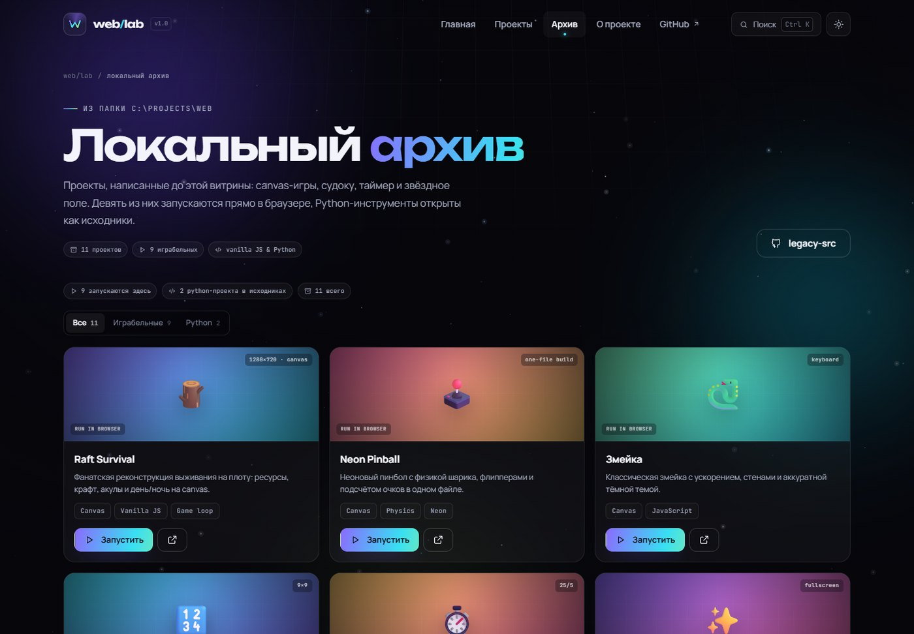
</div>

## Как это устроено

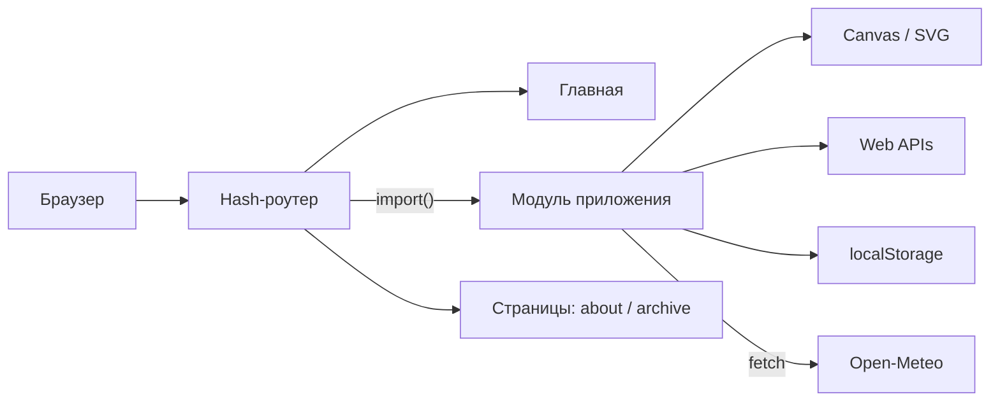

- **Один вход, много вселенных.** Каждое приложение — независимый модуль с `mount(root)` и функцией очистки. Роутер подгружает только нужный чанк.
- **Hash-роутинг** выбран осознанно: GitHub Pages не умеет отдавать `index.html` для вложенных путей, а `#/app/sky` работает всегда.
- **Без фреймворка.** Свой роутер, реестр приложений, компоненты, дизайн-токены и утилиты — чтобы показать платформу, а не обёртку.
- **Честные вычисления.** Звёздные координаты, фазы Луны, haversine, QR-матрицы, Markdown-парсер и SVG-графики написаны в репозитории.

### Стек

- **TypeScript 5** в strict-режиме, ES2022, никаких `any` в прикладной логике.
- **Vite 7** — dev server, code splitting, сборка статики.
- **Canvas 2D и SVG** — звёздное небо, треки, плитки 2048, графики.
- **Web APIs** — `fetch`, Web Crypto, Geolocation, Clipboard, FileReader, `IntersectionObserver`, Web Animations.
- **CSS** — свои токены, тёмная и светлая темы, адаптив, `prefers-reduced-motion`, 3D-трансформации.
- **Ноль бэкенда** — GitHub Pages, `localStorage`, публичные API без ключей.

### Структура

```text
web-projects/
├─ src/
│  ├─ apps/            # 11 приложений (по папке на приложение)
│  ├─ core/            # router, dom, motion, scene, toast, modal, confetti
│  ├─ components/      # nav, footer, command palette, превью карточек
│  ├─ pages/           # home, about, archive, app shell
│  ├─ data/            # реестр проектов, каталог звёзд, демо-рейтинги
│  └─ styles/          # design system + стили приложений
├─ public/
│  ├─ legacy/          # 9 архивных проектов
│  ├─ og-cover.png
│  ├─ favicon.svg
│  └─ 404.html
├─ legacy-src/         # Python-исходники архива
├─ docs/               # скриншоты для README
├─ index.html
├─ vite.config.ts
└─ package.json
```

## Запуск

```bash
git clone https://github.com/d1m40fficial/web-projects.git
cd web-projects
npm install
npm run dev
```

Сайт откроется на `http://localhost:5173/web-projects/`.

```bash
npm run check     # tsc --noEmit
npm run build     # typecheck + production build в dist/
npm run preview   # локальный просмотр сборки
```

## Деплой

Исходники живут в ветке `main`, собранный сайт — в `gh-pages`. GitHub Pages настроен на `gh-pages / (root)`.

```bash
npm run build

cd dist
git init -b gh-pages
git add -A
git commit -m "deploy: web/lab"
git push -f https://github.com/d1m40fficial/web-projects.git gh-pages
```

> В сборке используется `base: '/web-projects/'`, поэтому пути к ассетам и iframe-играм корректны и на Pages, и в локальном dev-сервере.

## Данные и честность

- **Погода и города** — [Open-Meteo](https://open-meteo.com/), без API-ключей. Если сервис недоступен, включается **демо-режим**: интерфейс работает, но цифры сгенерированы и помечены плашкой.
- **Карта неба** — каталог ярких звёзд J2000, приблизительные координаты и цвета; расчёт `alt/az` через звёздное время, Солнце и Луна — по низкоточным астрономическим формулам. Это планетарий для наглядности, а не астрометрия.
- **Дашборд** — демонстрационный каталог из 61 фильма и книги. Оценки округлены и приблизительны; это не официальные данные IMDb или Goodreads.
- **Локальный архив** — проекты написаны до витрины и встроены без переписывания. Raft Survival — некоммерческая фанатская работа, см. [CREDITS](public/legacy/raft/CREDITS.txt).
- **Приватность** — нет аналитики, cookies, аккаунтов и серверного кода. Заметки, пароли, рекорды и палитры остаются в браузере.

## Доступность и производительность

- Клавиатурная навигация, видимый `:focus-visible`, семантические ориентиры и `aria`-подписи.
- `prefers-reduced-motion` отключает декоративное движение, но сохраняет обратную связь.
- Контраст проверяется в палитрах по WCAG AA/AAA; обе темы проходят по основному тексту.
- Главная не тянет код приложений: каждый экран — отдельный чанк, загружаемый по маршруту.
- Графики, звёзды и треки рисуются на canvas с учётом `devicePixelRatio`; никаких тяжёлых chart-библиотек.

## Лицензия

Код и дизайн витрины — [MIT](LICENSE). Архивные проекты и сторонние данные остаются под своими условиями; подробности — в [LICENSE](LICENSE) и `public/legacy/raft/CREDITS.txt`.

---

<div align="center">

Сделано вручную · **d1m40fficial** · 2026

[GitHub](https://github.com/d1m40fficial) · [Live demo](https://d1m40fficial.github.io/web-projects/) · [Issues](https://github.com/d1m40fficial/web-projects/issues)

</div>
